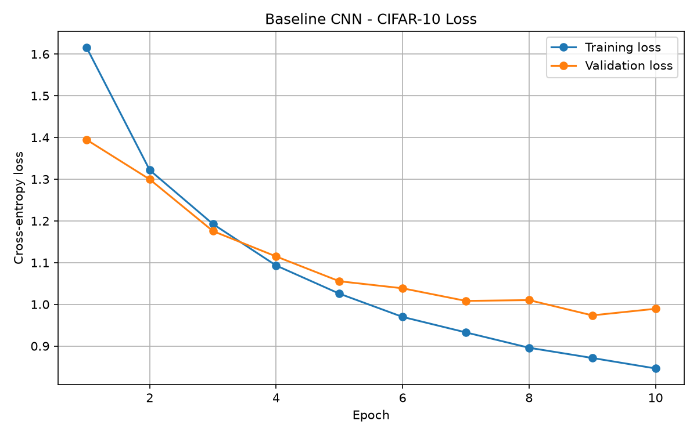
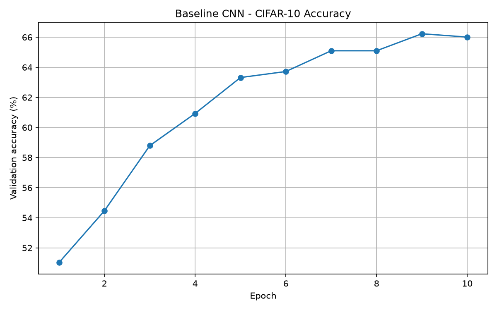

# Efficient Edge AI

A machine learning engineering project exploring the trade-offs
between neural network accuracy, model size, and inference speed.

## Project Goal

Investigate how neural networks can be optimized for efficient
inference on resource-constrained devices.

## Planned Experiments

1. Train a baseline CNN using PyTorch.
2. Compare lightweight neural network architectures.
3. Apply model compression techniques.
4. Benchmark accuracy, model size, and inference latency.
5. Analyze the trade-offs between efficiency and performance.

## Technologies

- Python
- PyTorch
- NumPy
- Matplotlib

## Current Status

### Phase 1: PyTorch Foundations

**Status: Completed — November 2, 2026**

Completed:
- Set up the Python development environment with PyTorch.
- Practiced tensor operations and automatic differentiation (autograd).
- Implemented gradient descent manually using PyTorch.
- Built and trained a multilayer perceptron (MLP) using `torch.nn`.
- Used Mean Squared Error (MSE) and the Adam optimizer.
- Implemented reproducible training, validation, and test splits.
- Evaluated the trained network on held-out observations.
- Practiced inference using a trained model.

### Training and Evaluation

As an introductory exercise, a 1–8–1 multilayer perceptron was trained to approximate the function \(y = 3x + 2\).

**Experimental setup:**
- Dataset: 100 synthetic observations.
- Split: 70 training, 15 validation, and 15 test samples.
- Optimizer: Adam (learning rate = 0.01).
- Loss function: Mean Squared Error (MSE).
- Training duration: 500 epochs.

**Results:**

| Dataset | MSE |
|---|---:|
| Training | 0.01986 |
| Validation | 0.02577 |
| Test | 0.01769 |

The model achieved low prediction errors on both training and held-out data, suggesting that it learned to approximate the underlying relationship.

These experiments are introductory PyTorch exercises and are separate from the main Efficient Edge AI benchmarks.

The code is available in the `learning/` directory.

### Phase 2: CNN Baseline on CIFAR-10

A lightweight convolutional neural network was implemented in PyTorch to establish a baseline for image classification before evaluating more efficient architectures such as MobileNetV3.

### Architecture

- Two convolutional layers with 16 and 32 output channels
- ReLU activations and 2×2 max pooling
- Flatten layer and fully connected classifier with 10 outputs

### Experimental Setup

| Parameter | Value |
|---|---|
| Dataset | CIFAR-10 |
| Training images | 40,000 |
| Validation images | 10,000 |
| Batch size | 64 |
| Optimizer | Adam |
| Learning rate | 0.001 |
| Loss function | CrossEntropyLoss |
| Training epochs | 10 |
| Random seed | 42 |

### Results

The baseline CNN achieved a **best validation accuracy of 66.23% at epoch 9**, with a corresponding validation loss of **0.9736**.

Training loss decreased from 1.6160 to 0.8464 across ten epochs, demonstrating that the network learned useful image representations. Validation accuracy also improved substantially, although a small decrease in accuracy during the final epoch suggests that further training should be monitored for overfitting.

The best-performing model weights were saved locally in `checkpoints/baseline_cnn_best.pth`.

### Learning Curves

### Reproducing the Experiment

Install PyTorch, torchvision, and Matplotlib, then run `experiments/baseline_cnn.py` from the project root with CIFAR-10 downloaded in the `data/` directory.

The experiment uses a fixed random seed and a 40,000/10,000 training-validation split. Model checkpoints and downloaded datasets are excluded from version control.

### Next Steps

Compare the baseline CNN against MobileNetV3 using consistent dataset splits and evaluation procedures, then investigate model compression, inference latency, and memory requirements for edge deployment.